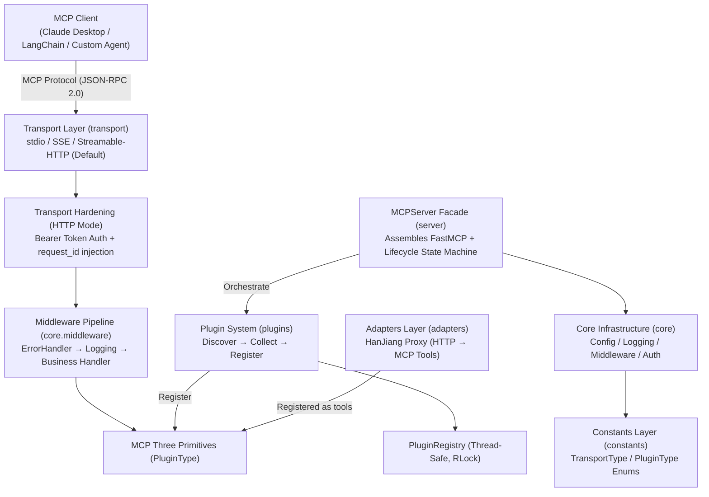
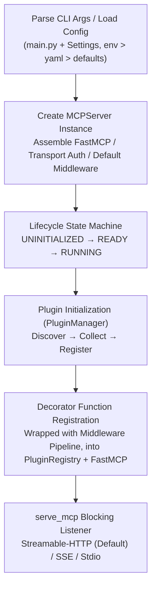
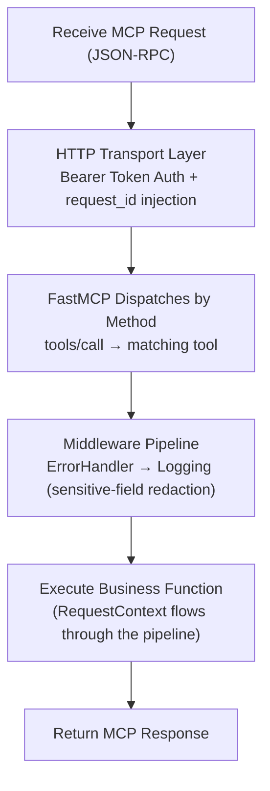
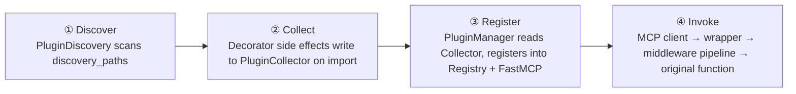

[中文](README.md) | English

# x-QiuChi


---

## 💡 Project Introduction

**x-QiuChi** is an enterprise-grade MCP server framework for production environments. Built on the official MCP Python SDK (FastMCP), it fills in the enterprise-grade capabilities developers need, letting you expose business capabilities to the AI ecosystem with minimal effort.

**Key Features:**

- **Full MCP primitive coverage**: tools / resources / prompts with unified declarative decorators (`@tool` / `@resource` / `@prompt`) — zero hand-coded protocol plumbing
- **Plugin architecture**: a `discover → collect → register` three-stage plugin system that auto-scans built-in extensions; business capabilities plug in and out as plugins
- **Middleware pipeline**: onion-model execution chain with built-in error handling (JSON-RPC standard error codes), request logging (automatic sensitive-field redaction), and request_id injection; custom middleware supported
- **Multi-transport**: `stdio` (Claude Desktop compatible) / `sse` / `streamable-http` (default), switch with one flag
- **Unified configuration**: environment variables > YAML > code defaults, with all three sources aligned
- **Transport-layer auth**: optional Bearer Token authentication mounted at the HTTP transport layer with access to real headers
- **Production quality gates**: GitHub Actions CI (lint + mypy + test coverage gate + build), Conventional Commits, full type annotations
- **Containerized deployment**: multi-stage Dockerfile (non-root user, real MCP handshake health check) + docker-compose orchestration
- **System integration adapters**: built-in HanJiang management system adapter (HTTP proxy) demonstrating how to wrap any external HTTP system as MCP capabilities

**Use Cases:**

- Quickly connect internal systems (auth, users, data) to AI clients (Claude Desktop / LangChain / custom agents)
- Build discoverable, callable tool/resource/prompt services for LLM applications
- Act as an MCP gateway that uniformly exposes capabilities from multiple systems

## 🚀 Quick Start

### 1. Environment Requirements

| Platform | Requirements |
|----------|--------------|
| **Windows** | Windows 10/11, PowerShell 5.1+, install [uv](https://docs.astral.sh/uv/): `powershell -ExecutionPolicy ByPass -c "irm https://astral.sh/uv/install.ps1 \| iex"` |
| **Linux** | Python 3.11+ optional (uv manages it), install uv: `curl -LsSf https://astral.sh/uv/install.sh \| sh` |
| **macOS** | Same as above, install uv: `curl -LsSf https://astral.sh/uv/install.sh \| sh` |

> uv automatically installs and manages the required Python version (this project requires Python ≥ 3.11). No manual interpreter setup needed.

### 2. Clone the Repository

```bash
git clone https://github.com/chain-engine/x-QiuChi.git
cd x-QiuChi
```

### 3. Install Dependencies

```bash
# Install project dependencies (including dev deps: pytest/ruff/mypy)
uv sync --all-extras
```

### 4. Environment Configuration

The project supports a three-level configuration system: **environment variables > YAML > code defaults**. Use either or combine them:

```bash
# Option 1 (recommended): create your env file from the template
cp .env.example .env

# Option 2: create your YAML config from the template
cp config.yaml.example config.yaml
```

**Core configuration (the prefix maps to the env var naming rule, e.g. `MCP_`, `LOGGING_`, `AUTH_`, `HANJIANG_`):**

| Section | Env Var Example | Default | Description |
|---------|-----------------|---------|-------------|
| `mcp.server_name` | `MCP_SERVER_NAME` | `QiuChi` | Server name |
| `mcp.transport` | `MCP_TRANSPORT` | `streamable-http` | Transport type: `stdio` / `sse` / `streamable-http` |
| `mcp.host` | `MCP_HOST` | `0.0.0.0` | HTTP listen address |
| `mcp.port` | `MCP_PORT` | `8888` | HTTP listen port |
| `logging.level` | `LOGGING_LEVEL` | `INFO` | Log level |
| `logging.file_path` | `LOGGING_FILE_PATH` | `logs/x-QiuChi_*.log` | Log file path (supports time template) |
| `plugins.auto_discovery` | `PLUGIN_AUTO_DISCOVERY` | `true` | Enable plugin auto-discovery |
| `plugins.discovery_paths` | `PLUGIN_DISCOVERY_PATHS` | `["src.plugins.builtin"]` | Plugin scan paths |
| `middleware.auth.enabled` | `AUTH_ENABLED` | `false` | Enable transport-layer Bearer Token auth |
| `middleware.auth.tokens` | `AUTH_TOKENS` | `[]` | Valid Bearer tokens (required when enabled) |
| `hanjiang.base_url` | `HANJIANG_BASE_URL` | `http://localhost` | HanJiang backend base URL |
| `hanjiang.username` | `HANJIANG_USERNAME` | `""` | HanJiang service credential username |
| `hanjiang.password` | `HANJIANG_PASSWORD` | `""` | HanJiang service credential password (sensitive, .env only) |
| `hanjiang.encryption_enabled` | `HANJIANG_ENCRYPTION_ENABLED` | `true` | RSA-OAEP password encryption |
| `hanjiang.timeout` | `HANJIANG_TIMEOUT` | `30` | HanJiang request timeout (seconds) |

> Full configuration list: see [config.yaml.example](config.yaml.example) and [.env.example](.env.example). `mcp.version` does not read from env — the single source of truth for version is `pyproject.toml`.

### 5. Start the Server

**Option A: Local development**

```bash
# Start streamable-http by default (port 8888)
uv run x-QiuChi

# Equivalent (same as python -m src.main)
uv run python -m src.main

# Custom startup arguments
uv run x-QiuChi --transport stdio          # switch to stdio transport
uv run x-QiuChi --port 8080                # change HTTP port
uv run x-QiuChi --log-level DEBUG          # adjust log level
```

**Option B: Docker container deployment**

```bash
# Build and start with one command (port 8888, logs volume, automatic health check)
docker compose up -d --build

# Check status and logs
docker compose ps
docker compose logs -f qiuchi-mcp

# Stop
docker compose down
```

### 6. Common Engineering Commands

```bash
# Unit tests (with coverage; coverage gate 45%)
uv run pytest

# Code formatting (auto-fix)
uv run ruff format src/ tests/
uv run ruff check --fix src/ tests/

# Static checks
uv run ruff check src/ tests/
uv run ruff format --check src/ tests/

# Type checking
uv run mypy src/

# Build distribution packages (wheel + sdist)
uv build

# Dependency vulnerability scan
uv pip audit
```

> Before committing, make sure `ruff check`, `ruff format --check`, `mypy src/`, and `pytest` are all green. The repo ships git hooks (`hooks/pre-commit`, `hooks/commit-msg`) and GitHub Actions CI that enforce the same gates.

### 7. Usage Examples

**Connect with the official MCP client and call a tool** (full example: [examples/mcp_clients/mcp_client.py](examples/mcp_clients/mcp_client.py)):

```python
import asyncio
from mcp import ClientSession, StdioServerParameters
from mcp.client.stdio import stdio_client

async def main() -> None:
    server_params = StdioServerParameters(
        command="uv", args=["run", "x-QiuChi", "--transport", "stdio"]
    )
    async with stdio_client(server_params) as (read, write):
        async with ClientSession(read, write) as session:
            await session.initialize()
            tools = await session.list_tools()
            result = await session.call_tool("add", {"a": 1, "b": 2})
            print(result)

asyncio.run(main())
```

**Use as a Claude Desktop MCP server** (`claude_desktop_config.json`):

```json
{
  "mcpServers": {
    "qiuchi": {
      "command": "uv",
      "args": ["run", "x-QiuChi", "--transport", "stdio"]
    }
  }
}
```

**Connect via HTTP with LangChain** (full example: [examples/mcp_clients/langchain_mcp_client.py](examples/mcp_clients/langchain_mcp_client.py)):

```python
from langchain_mcp_adapters.client import MultiServerMCPClient

async with MultiServerMCPClient(
    {"qiuchi": {"transport": "http", "url": "http://localhost:8888/mcp"}}
) as client:
    tools = client.get_tools()
```

### 8. Troubleshooting

| Issue | Solution |
|-------|----------|
| **Port already in use** | `netstat -ano \| findstr :8888` to locate and release the process, or `uv run x-QiuChi --port 8080` |
| **uv install fails / network timeout** | Use a mirror index: `UV_DEFAULT_INDEX=https://mirrors.aliyun.com/pypi/simple/`; Docker build already bundles mirror acceleration |
| **Config not applied / load error** | Check `.env` / `config.yaml` align with `.env.example` / `config.yaml.example`; env vars override YAML |
| **HanJiang adapter connection failed (All connection attempts failed)** | Verify the actual listening port of the HanJiang backend and update `HANJIANG_BASE_URL` (Docker deployments commonly use port 80); ensure `HANJIANG_USERNAME/PASSWORD` are set |
| **401 / no permission on tool calls** | Clients must carry the Bearer Token (matching `AUTH_TOKENS`) when auth is enabled; permission codes on the HanJiang side define the AI's operational boundary |
| **Slow Docker build** | Use a mirror (Dockerfile already includes the aliyun PyPI mirror); ensure `uv.lock` matches `pyproject.toml` |

## 📁 Project Structure

```text
x-QiuChi/
├── src/                              # Source root
│   ├── main.py                       # Entry: CLI parsing, config assembly, server startup
│   ├── constants/                    # Constants layer: global enums & base constants
│   │   ├── enums.py                  # Environment / LogLevel / TransportType / PluginType enums
│   │   ├── constants.py              # Version, author, description, etc.
│   │   └── base.py                   # Common base constants
│   ├── core/                         # Core layer: framework infrastructure
│   │   ├── config.py                 # Settings management (dataclass sections, env>yaml>defaults, validation)
│   │   ├── logger.py                 # loguru structured logging (rotation, sensitive filtering)
│   │   ├── middleware.py             # Middleware pipeline (ErrorHandler / Logging / MiddlewareChain / RequestContext)
│   │   └── auth.py                   # Transport-layer auth (Bearer Token verifier, MCP TokenVerifier Protocol)
│   ├── plugins/                      # Plugin layer: plugin system core + built-in extensions
│   │   ├── discovery.py              # PluginDiscovery: scans discovery_paths, imports trigger decorator collection
│   │   ├── collector.py              # PluginCollector: process-global collector + three decorators
│   │   ├── registry.py               # PluginRegistry: unified registry (tools/resources/prompts + metadata)
│   │   ├── manager.py                # PluginManager: facade orchestrating discover → collect → register
│   │   └── builtin/                  # Built-in extensions (the only discovery scan area)
│   │       ├── tools/math.py         # 5 math tools (add/subtract/multiply/divide/sqrt)
│   │       ├── resources/config.py   # 3 config resources (config://server, config://version, docs://api)
│   │       └── prompts/templates.py  # 4 prompt templates (greeting/code_review/weather/summarize)
│   ├── adapters/                     # Adapter layer: external system integration (HTTP proxy)
│   │   └── hanjiang/                 # HanJiang management system adapter (auth + user management, 10 tools)
│   │       ├── client.py             # HanJiangClient: RSA-OAEP login / token lifecycle / error mapping
│   │       ├── auth_tools.py         # Auth tools (login / logout / session_info)
│   │       └── user_tools.py         # User tools (create / list / get / update / status / reset / delete)
│   ├── server/                       # Server layer: MCP server core
│   │   ├── server.py                 # MCPServer facade (assembles FastMCP / auth / middleware / plugins / lifecycle)
│   │   └── lifecycle.py              # Server lifecycle state machine (UNINITIALIZED → RUNNING → STOPPED)
│   ├── transport/                    # Transport layer: multi-protocol transport abstraction
│   │   └── transport.py              # Transport config, request_id injection (X-Request-ID / ContextVar), serving
│   └── utils/                        # Utils layer: general helpers
│       └── helpers.py                # General helpers (time formatting, etc.)
├── tests/                            # Test suite (11 test modules, 110+ cases)
├── examples/                         # Examples
│   ├── mcp_clients/                  # MCP client integration examples (official SDK / LangChain)
│   └── mcp_servers/                  # Standalone MCP server example (weather)
├── .github/workflows/ci.yml          # GitHub Actions CI (lint / mypy / test / build)
├── hooks/                            # git hooks (pre-commit / commit-msg enforcement)
├── scripts/                          # Engineering scripts (commit message check, etc.)
├── config.yaml / config.yaml.example # YAML configuration (templates)
├── .env / .env.example               # Environment variable configuration (templates)
├── Dockerfile                        # Multi-stage build (non-root, health check)
├── docker-compose.yml                # Container orchestration
├── pyproject.toml                    # Project metadata / deps / tool config (uv/ruff/mypy/pytest)
└── LICENSE                           # MIT License
```

## 🏗️ System Architecture

### Layered Architecture



### Core Business Flows

**Server Startup Flow:**



**Request Processing Flow:**



**Plugin Lifecycle (Decorator Plugins):**



### Key Components

| Component | Module | Responsibility |
|-----------|--------|----------------|
| **MCPServer** | `src/server/server.py` | Orchestration facade: assembles FastMCP / auth / middleware / plugins / lifecycle; the only entry point |
| **LifecycleManager** | `src/server/lifecycle.py` | Server lifecycle state machine (UNINITIALIZED → READY → RUNNING → STOPPED) |
| **PluginManager** | `src/plugins/manager.py` | Plugin system facade: orchestrates discover → collect → register |
| **PluginDiscovery** | `src/plugins/discovery.py` | Scans `discovery_paths` and imports modules, triggering decorator collection (throwaway) |
| **PluginCollector** | `src/plugins/collector.py` | Process-global collector; `@tool` etc. write automatically on import |
| **PluginRegistry** | `src/plugins/registry.py` | Unified registry: tools/resources/prompts + metadata (thread-safe, RLock) |
| **MiddlewareChain** | `src/core/middleware.py` | Onion-model middleware execution chain + RequestContext/ResponseContext |
| **ErrorHandlerMiddleware** | `src/core/middleware.py` | Error fallback: JSON-RPC standard codes (-32700 ~ -32603) + custom business codes |
| **LoggingMiddleware** | `src/core/middleware.py` | Request/response logs, latency stats, sensitive-field (password/token/key) redaction |
| **Settings** | `src/core/config.py` | Config management: dataclass sections, env > yaml > defaults, validation |
| **HanJiangClient** | `src/adapters/hanjiang/client.py` | HanJiang HTTP proxy client: RSA-OAEP login, token lifecycle, error mapping |
| **Transport** | `src/transport/transport.py` | Transport config and request_id injection (X-Request-ID / ContextVar), multi-protocol serving |

## 🧰 Tech Stack

| Category | Technology | Purpose |
|----------|------------|---------|
| **Language** | Python ≥ 3.11 | Development language |
| **Protocol** | [MCP Python SDK (FastMCP)](https://github.com/modelcontextprotocol/python-sdk) ≥ 1.0 | MCP protocol: primitive registration, transport, client |
| **HTTP Client** | [httpx](https://www.python-httpx.org/) ≥ 0.27 | Async HTTP requests (HanJiang adapter, health checks) |
| **Logging** | [loguru](https://loguru.readthedocs.io/) ≥ 0.7 | Structured logging, rotation, sensitive filtering |
| **Config** | [pydantic](https://docs.pydantic.dev/) / [pydantic-settings](https://docs.pydantic.dev/settings/) ≥ 2.0 | Config models & validation |
| **Config Parsing** | [PyYAML](https://pyyaml.org/) ≥ 6.0 | YAML config loading |
| **Crypto** | [pycryptodome](https://www.pycryptodome.org/) ≥ 3.24 | RSA-OAEP(SHA-256) encryption (HanJiang login) |
| **Package Manager** | [uv](https://docs.astral.sh/uv/) | Dependency install/sync, venv, build |
| **Testing** | [pytest](https://docs.pytest.org/) / pytest-asyncio / pytest-cov | Unit/integration/protocol tests, coverage gate 45% |
| **Code Quality** | [ruff](https://docs.astral.sh/ruff/) | Lint + format (E/F/I/N/W/UP/B/C4/SIM) |
| **Type Checking** | [mypy](https://mypy.readthedocs.io/) | Static type checking (zero errors on src) |
| **CI/CD** | [GitHub Actions](https://github.com/features/actions) | lint / typecheck / test / build pipeline |
| **Containerization** | [Docker](https://www.docker.com/) / docker-compose | Multi-stage build, non-root, health check |

## 📡 API Documentation

This project **does not expose a REST API** (no Swagger / ReDoc / OpenAPI endpoints). The external interface is the **MCP protocol** (JSON-RPC 2.0), exposed over the following transports:

| Transport | Connection | Description |
|-----------|------------|-------------|
| `streamable-http` (default) | `POST http://<host>:8888/mcp` | Streamable HTTP, suitable for remote access |
| `stdio` | stdin/stdout | Local clients like Claude Desktop |
| `sse` | `GET http://<host>:8888/sse` | Server-Sent Events |

**Core JSON-RPC methods (MCP protocol methods):**

| Category | Methods | Description |
|----------|---------|-------------|
| Lifecycle | `initialize` / `notifications/initialized` / `ping` | Handshake, version negotiation, heartbeat |
| Tools | `tools/list` / `tools/call` | Discover tools, call tools |
| Resources | `resources/list` / `resources/read` | Discover resources, read resources |
| Prompts | `prompts/list` / `prompts/get` | Discover prompts, fetch prompt templates |

**Built-in capabilities:**

- **Tools (15)**: math (5): `add` / `subtract` / `multiply` / `divide` / `sqrt`; HanJiang (10): `hanjiang_login` / `hanjiang_logout` / `hanjiang_session_info` / `hanjiang_user_create` / `hanjiang_user_list` / `hanjiang_user_get` / `hanjiang_user_update` / `hanjiang_user_status` / `hanjiang_user_reset_password` / `hanjiang_user_delete`
- **Resources (3)**: `config://server`, `config://version`, `docs://api`
- **Prompts (4)**: `greeting`, `code_review`, `weather_outfit_advice`, `summarize_document`

**Access Control:**

- Transport-layer auth: when `middleware.auth.enabled=true`, HTTP requests must carry `Authorization: Bearer <token>` (token must match `AUTH_TOKENS`)
- Adapter permissions: user permission codes on the HanJiang side define the AI's operational tool boundary (recommend a least-privilege dedicated account for the adapter)

## 💾 Storage Configuration

This project has **no business database / object storage**. The only persistent output is **file logs**:

| Config | Default | Description |
|--------|---------|-------------|
| `logging.output` | `both` | Output target: `stderr` / `file` / `both` |
| `logging.file_path` | `logs/x-QiuChi_{time:YYYY-MM-DD-HH}.log` | Log file path (supports `{time}` template) |
| `logging.rotation` | `1 hour` | Log rotation period |
| `logging.retention` | `7 days` | Log retention duration |
| `logging.format` | structured format | loguru format (time/level/file/line) |

> In Docker deployments, the log directory is mounted to the `qiuchi-logs` named volume; view logs with `docker compose logs`. Sensitive fields (passwords/tokens/keys) in logs are automatically redacted by `LoggingMiddleware`.

## 📜 License

This project is released under the [MIT License](LICENSE). Free to use, modify, and distribute (retaining the copyright notice).

## 📚 References

- [MCP Protocol Specification](https://modelcontextprotocol.io/specification/2025-03-26) — Model Context Protocol official spec
- [MCP Python SDK (FastMCP)](https://github.com/modelcontextprotocol/python-sdk) — official Python implementation
- [Python Documentation](https://docs.python.org/3.11/) — Python 3.11
- [uv Package Manager](https://docs.astral.sh/uv/) — dependency management & build
- [loguru Docs](https://loguru.readthedocs.io/) — logging library
- [httpx Docs](https://www.python-httpx.org/) — HTTP client
- [pycryptodome Docs](https://www.pycryptodome.org/) — crypto library
- [pydantic Docs](https://docs.pydantic.dev/) — config & validation
- [ruff Docs](https://docs.astral.sh/ruff/) — lint & format
- [mypy Docs](https://mypy.readthedocs.io/) — type checking
- [pytest Docs](https://docs.pytest.org/) — testing framework
- [Docker Docs](https://docs.docker.com/) — containerized deployment

## 📬 Contact

- **Author**: John Young（夜雨诗来）
- **Email**: john.young@foxmail.com
- **Gitee**: https://gitee.com/yeyushilai
- **GitHub**: https://github.com/yeyushilai
- **Project**: https://github.com/chain-engine/x-QiuChi
