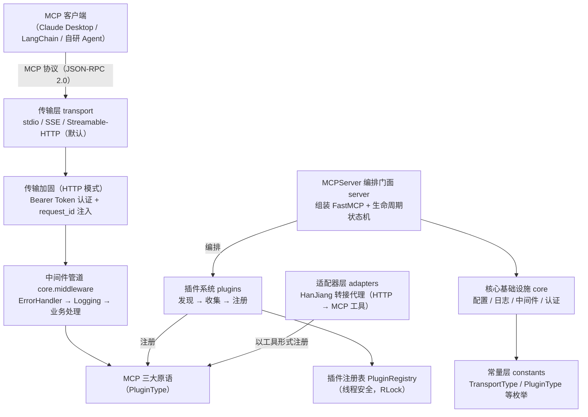
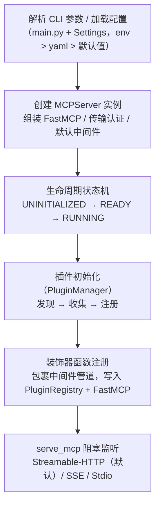
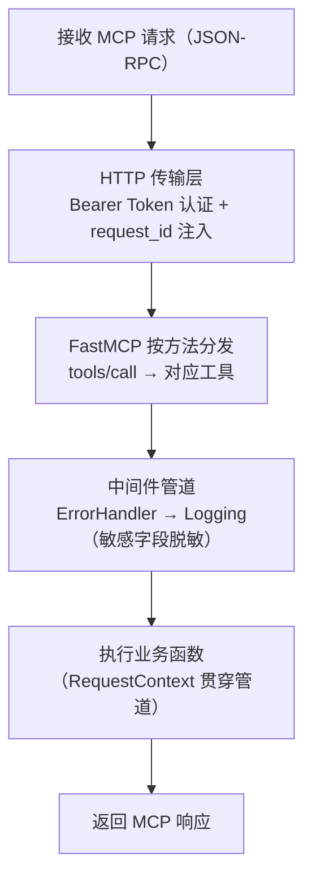
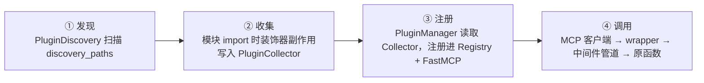

[English](README.en.md) | 中文

# x-QiuChi（秋池）


***

## 💡 项目介绍

**x-QiuChi（秋池）** 是一个面向生产环境的企业级 MCP 服务器框架，在官方 MCP Python SDK（FastMCP）之上补齐了企业应用所需的能力封装，让开发者用最小的成本把业务能力接入 AI 生态。

**核心特性：**

- **MCP 三大原语全覆盖**：工具（tools）、资源（resources）、提示词（prompts），统一装饰器声明式定义（`@tool` / `@resource` / `@prompt`），协议层零手工编码
- **插件化架构**：`发现 → 收集 → 注册` 三段式插件系统，自动扫描内建扩展，业务功能以插件形式即插即用
- **中间件管道**：洋葱模型执行链，内置错误处理（JSON-RPC 标准错误码）、请求日志（敏感字段自动脱敏）、request\_id 注入，支持自定义中间件扩展
- **多传输协议**：`stdio`（Claude Desktop 兼容）/ `sse` / `streamable-http`（默认），一条命令切换
- **统一配置系统**：环境变量 > YAML > 代码默认值 三级优先级，全部配置项三来源对齐
- **传输层认证**：可选 Bearer Token 认证，挂载于 HTTP 传输层，可拿到真实请求头
- **生产级质量门禁**：GitHub Actions CI（lint + mypy + 测试覆盖率门禁 + 构建）、Conventional Commits 提交规范、全量类型注解
- **容器化部署**：多阶段 Dockerfile（非 root 运行、真实 MCP 握手健康检查）+ docker-compose 一键编排
- **集成三方适配器**：内置汉江管理系统适配器（HTTP 转接代理），演示如何把任意外部 HTTP 系统包装为 MCP 能力

**适用场景：**

- 企业内部系统（认证、用户、数据）快速接入 AI 客户端（Claude Desktop / LangChain / 自研 Agent）
- 为 LLM 应用构建可发现、可调用的工具/资源/提示词服务
- 作为 MCP 网关/转接层，统一对外暴露多系统能力

## 🚀 快速开始

### 1. 环境要求

| 平台          | 要求                                                                                                                                                      |
| ----------- | ------------------------------------------------------------------------------------------------------------------------------------------------------- |
| **Windows** | Windows 10/11，PowerShell 5.1+，安装 [uv](https://docs.astral.sh/uv/)：`powershell -ExecutionPolicy ByPass -c "irm https://astral.sh/uv/install.ps1 \| iex"` |
| **Linux**   | Python 3.11+ 可选（uv 自动管理），安装 uv：`curl -LsSf https://astral.sh/uv/install.sh \| sh`                                                                       |
| **macOS**   | 同上，安装 uv：`curl -LsSf https://astral.sh/uv/install.sh \| sh`                                                                                             |

> uv 会自动安装并管理所需的 Python 版本（项目要求 Python ≥ 3.11），无需手动配置解释器。

### 2. 项目代码克隆

```bash
git clone https://github.com/chain-engine/x-QiuChi.git
cd x-QiuChi
```

### 3. 依赖同步安装

```bash
# 安装项目依赖（含开发依赖：pytest/ruff/mypy）
uv sync --all-extras
```

### 4. 环境配置

项目支持 **环境变量 > YAML > 代码默认值** 三级配置，任选一种或组合使用：

```bash
# 方式一（推荐）：基于 .env.example 创建环境变量文件
cp .env.example .env

# 方式二：基于 config.yaml.example 创建 YAML 配置文件
cp config.yaml.example config.yaml
```

**核心配置项（前缀即环境变量名规则，如** **`MCP_`、`LOGGING_`、`AUTH_`、`HANJIANG_`）：**

| 配置段                           | 环境变量示例                        | 默认值                       | 说明                                       |
| ----------------------------- | ----------------------------- | ------------------------- | ---------------------------------------- |
| `mcp.server_name`             | `MCP_SERVER_NAME`             | `QiuChi`                  | 服务器名称                                    |
| `mcp.transport`               | `MCP_TRANSPORT`               | `streamable-http`         | 传输类型：`stdio` / `sse` / `streamable-http` |
| `mcp.host`                    | `MCP_HOST`                    | `0.0.0.0`                 | HTTP 监听地址                                |
| `mcp.port`                    | `MCP_PORT`                    | `8888`                    | HTTP 监听端口                                |
| `logging.level`               | `LOGGING_LEVEL`               | `INFO`                    | 日志级别                                     |
| `logging.file_path`           | `LOGGING_FILE_PATH`           | `logs/x-QiuChi_*.log`     | 日志文件路径（支持时间模板）                           |
| `plugins.auto_discovery`      | `PLUGIN_AUTO_DISCOVERY`       | `true`                    | 是否自动发现插件                                 |
| `plugins.discovery_paths`     | `PLUGIN_DISCOVERY_PATHS`      | `["src.plugins.builtin"]` | 插件扫描路径                                   |
| `middleware.auth.enabled`     | `AUTH_ENABLED`                | `false`                   | 是否启用传输层 Bearer Token 认证                  |
| `middleware.auth.tokens`      | `AUTH_TOKENS`                 | `[]`                      | 有效 Bearer Token 列表（enabled 时必填）          |
| `hanjiang.base_url`           | `HANJIANG_BASE_URL`           | `http://localhost`        | 汉江管理系统后端地址                               |
| `hanjiang.username`           | `HANJIANG_USERNAME`           | `""`                      | 汉江服务凭据账号                                 |
| `hanjiang.password`           | `HANJIANG_PASSWORD`           | `""`                      | 汉江服务凭据密码（敏感，仅放 .env）                     |
| `hanjiang.encryption_enabled` | `HANJIANG_ENCRYPTION_ENABLED` | `true`                    | 是否 RSA-OAEP 加密密码                         |
| `hanjiang.timeout`            | `HANJIANG_TIMEOUT`            | `30`                      | 汉江请求超时（秒）                                |

> 完整配置项见 [config.yaml.example](config.yaml.example) 与 [.env.example](.env.example)。`mcp.version` 不走环境变量——版本唯一事实源为 `pyproject.toml`。

### 5. 服务启动

**方式一：本地开发启动**

```bash
# 默认启动 streamable-http（端口 8888）
uv run x-QiuChi

# 等价写法（等价于 python -m src.main）
uv run python -m src.main

# 自定义启动参数
uv run x-QiuChi --transport stdio          # 切换为标准输入输出传输
uv run x-QiuChi --port 8080                # 更换 HTTP 端口
uv run x-QiuChi --log-level DEBUG          # 调整日志级别
```

**方式二：Docker 容器部署**

```bash
# 一键构建并启动（端口 8888，日志挂载卷，自动健康检查）
docker compose up -d --build

# 查看运行状态与日志
docker compose ps
docker compose logs -f qiuchi-mcp

# 停止
docker compose down
```

### 6. 常用工程命令

```bash
# 单元测试（含覆盖率统计，覆盖率门禁 45%）
uv run pytest

# 代码格式化（自动修复）
uv run ruff format src/ tests/
uv run ruff check --fix src/ tests/

# 静态检查
uv run ruff check src/ tests/
uv run ruff format --check src/ tests/

# 类型检查
uv run mypy src/

# 构建发行包（wheel + sdist）
uv build

# 依赖漏洞扫描
uv pip audit
```

> 提交前请确保：`ruff check`、`ruff format --check`、`mypy src/`、`pytest` 四项全绿。仓库已配置 git hooks（`hooks/pre-commit`、`hooks/commit-msg`）与 GitHub Actions CI 自动执行同样门禁。

### 7. 使用方法示例

**用官方 MCP 客户端连接并调用工具**（完整示例见 [examples/mcp\_clients/mcp\_client.py](examples/mcp_clients/mcp_client.py)）：

```python
import asyncio
from mcp import ClientSession, StdioServerParameters
from mcp.client.stdio import stdio_client

async def main() -> None:
    server_params = StdioServerParameters(
        command="uv", args=["run", "x-QiuChi", "--transport", "stdio"]
    )
    async with stdio_client(server_params) as (read, write):
        async with ClientSession(read, write) as session:
            await session.initialize()
            tools = await session.list_tools()
            result = await session.call_tool("add", {"a": 1, "b": 2})
            print(result)

asyncio.run(main())
```

**作为 Claude Desktop 的 MCP 服务器**（`claude_desktop_config.json`）：

```json
{
  "mcpServers": {
    "qiuchi": {
      "command": "uv",
      "args": ["run", "x-QiuChi", "--transport", "stdio"]
    }
  }
}
```

**HTTP 方式接入 LangChain**（完整示例见 [examples/mcp\_clients/langchain\_mcp\_client.py](examples/mcp_clients/langchain_mcp_client.py)）：

```python
from langchain_mcp_adapters.client import MultiServerMCPClient

async with MultiServerMCPClient(
    {"qiuchi": {"transport": "http", "url": "http://localhost:8888/mcp"}}
) as client:
    tools = client.get_tools()
```

### 8. 常见问题排查

| 问题                                            | 解决方案                                                                                           |
| --------------------------------------------- | ---------------------------------------------------------------------------------------------- |
| **端口被占用（Address already in use）**             | `netstat -ano \| findstr :8888` 定位进程后释放，或 `uv run x-QiuChi --port 8080` 换端口                    |
| **uv 安装失败 / 网络超时**                            | 国内环境配置镜像源：`UV_DEFAULT_INDEX=https://mirrors.aliyun.com/pypi/simple/`；Docker 构建已内置镜像加速          |
| **配置未生效 / 加载异常**                              | 检查 `.env` 与 `config.yaml` 是否与 `.env.example` / `config.yaml.example` 对齐；环境变量优先于 YAML           |
| **汉江适配器连接失败（All connection attempts failed）** | 确认汉江后端实际监听端口，修改 `HANJIANG_BASE_URL`（本机 Docker 部署常见为 80 端口）；确认 `HANJIANG_USERNAME/PASSWORD` 已填写 |
| **认证 401 / 工具调用无权限**                          | 开启认证后客户端需携带 Bearer Token（与 `AUTH_TOKENS` 一致）；汉江侧权限码决定 AI 可操作的工具边界                              |
| **Docker 构建慢**                                | 使用国内镜像源（Dockerfile 已内置 aliyun PyPI 镜像）；确保 `uv.lock` 与 `pyproject.toml` 一致                      |

## 📁 项目结构

```text
x-QiuChi/
├── src/                              # 源码根目录
│   ├── main.py                       # 入口：CLI 解析、配置装配、服务器启动
│   ├── constants/                    # 常量层：全局枚举与基础常量
│   │   ├── enums.py                  # Environment / LogLevel / TransportType / PluginType 等枚举
│   │   ├── constants.py              # 版本、作者、描述等全局常量
│   │   └── base.py                   # 通用基础常量定义
│   ├── core/                         # 核心层：框架基础设施
│   │   ├── config.py                 # Settings 配置管理（dataclass 分节、env>yaml>默认值、校验）
│   │   ├── logger.py                 # loguru 结构化日志（文件轮转、敏感字段过滤）
│   │   ├── middleware.py             # 中间件管道（ErrorHandler / Logging / MiddlewareChain / RequestContext）
│   │   └── auth.py                   # 传输层认证（Bearer Token 验证器，MCP TokenVerifier Protocol）
│   ├── plugins/                      # 插件层：插件系统核心 + 内建扩展
│   │   ├── discovery.py              # PluginDiscovery：扫描 discovery_paths，import 触发装饰器收集
│   │   ├── collector.py              # PluginCollector：进程级全局收集器 + 三大装饰器
│   │   ├── registry.py               # PluginRegistry：统一注册表（工具/资源/提示词 + 元数据）
│   │   ├── manager.py                # PluginManager：门面，编排「发现 → 收集 → 注册」
│   │   └── builtin/                  # 内建扩展插件（discovery 唯一扫描区）
│   │       ├── tools/math.py         # 5 个数学工具（add/subtract/multiply/divide/sqrt）
│   │       ├── resources/config.py   # 3 个配置资源（config://server、config://version、docs://api）
│   │       └── prompts/templates.py  # 4 个提示词模板（greeting/code_review/weather/summarize）
│   ├── adapters/                     # 适配器层：外部系统集成（HTTP 转接代理）
│   │   └── hanjiang/                 # 汉江管理系统适配器（认证 + 用户管理，10 个工具）
│   │       ├── client.py             # HanJiangClient：RSA-OAEP 登录 / token 生命周期 / 错误映射
│   │       ├── auth_tools.py         # 认证域工具（login / logout / session_info）
│   │       └── user_tools.py         # 用户域工具（create / list / get / update / status / reset / delete）
│   ├── server/                       # 服务层：MCP 服务器核心
│   │   ├── server.py                 # MCPServer 编排门面（组装 FastMCP / 认证 / 中间件 / 插件 / 生命周期）
│   │   └── lifecycle.py              # 服务器生命周期状态机（UNINITIALIZED → RUNNING → STOPPED）
│   ├── transport/                    # 传输层：多协议传输抽象
│   │   └── transport.py              # 传输配置、request_id 注入（X-Request-ID / ContextVar）与服务承载
│   └── utils/                        # 工具层：通用辅助函数
│       └── helpers.py                # 通用帮助函数（时间格式化等）
├── tests/                            # 测试套件（11 个测试模块，110+ 用例）
├── examples/                         # 示例代码
│   ├── mcp_clients/                  # MCP 客户端接入示例（官方 SDK / LangChain）
│   └── mcp_servers/                  # 独立 MCP 服务器示例（天气）
├── .github/workflows/ci.yml          # GitHub Actions CI（lint / mypy / test / build）
├── hooks/                            # git hooks（pre-commit / commit-msg 规范检查）
├── scripts/                          # 工程脚本（提交信息检查等）
├── config.yaml / config.yaml.example # YAML 配置（示例）
├── .env / .env.example               # 环境变量配置（示例）
├── Dockerfile                        # 多阶段构建（非 root、健康检查）
├── docker-compose.yml                # 容器编排
├── pyproject.toml                    # 项目元数据 / 依赖 / 工具配置（uv/ruff/mypy/pytest）
└── LICENSE                           # MIT 开源协议
```

## 🏗️ 系统架构

### 系统分层架构



### 核心业务流程

**服务器启动流程：**



**请求处理流程：**



**插件生命周期（装饰器插件）：**



### 关键技术组件

| 组件                         | 模块                                | 职责                                                    |
| -------------------------- | --------------------------------- | ----------------------------------------------------- |
| **MCPServer**              | `src/server/server.py`            | 编排门面：组装 FastMCP / 认证 / 中间件 / 插件 / 生命周期，对外唯一入口         |
| **LifecycleManager**       | `src/server/lifecycle.py`         | 服务器生命周期状态机（UNINITIALIZED → READY → RUNNING → STOPPED） |
| **PluginManager**          | `src/plugins/manager.py`          | 插件系统门面：编排「发现 → 收集 → 注册」三段流程                           |
| **PluginDiscovery**        | `src/plugins/discovery.py`        | 扫描 `discovery_paths` 并导入模块，触发装饰器收集（用后即弃）              |
| **PluginCollector**        | `src/plugins/collector.py`        | 进程级全局收集器；`@tool` 等装饰器在 import 时自动写入                   |
| **PluginRegistry**         | `src/plugins/registry.py`         | 统一注册表：工具/资源/提示词 + 元数据（线程安全，RLock）                     |
| **MiddlewareChain**        | `src/core/middleware.py`          | 洋葱模型中间件执行链 + RequestContext/ResponseContext           |
| **ErrorHandlerMiddleware** | `src/core/middleware.py`          | 错误兜底：JSON-RPC 标准错误码（-32700 \~ -32603）+ 自定义业务错误码       |
| **LoggingMiddleware**      | `src/core/middleware.py`          | 请求/响应日志、耗时统计、敏感字段（password/token/key）自动脱敏             |
| **Settings**               | `src/core/config.py`              | 配置管理：dataclass 分节、env > yaml > 默认值、按环境校验              |
| **HanJiangClient**         | `src/adapters/hanjiang/client.py` | 汉江系统 HTTP 转接客户端：RSA-OAEP 登录、token 生命周期、错误映射           |
| **Transport**              | `src/transport/transport.py`      | 传输配置与 request\_id 注入（X-Request-ID / ContextVar）、多协议承载 |

## 🧰 技术栈

| 分类           | 技术                                                                                                      | 用途                                     |
| ------------ | ------------------------------------------------------------------------------------------------------- | -------------------------------------- |
| **开发语言**     | Python ≥ 3.11                                                                                           | 项目开发语言                                 |
| **协议框架**     | [MCP Python SDK（FastMCP）](https://github.com/modelcontextprotocol/python-sdk) ≥ 1.0                     | MCP 协议封装：三大原语注册、传输承载、客户端               |
| **HTTP 客户端** | [httpx](https://www.python-httpx.org/) ≥ 0.27                                                           | 异步 HTTP 请求（汉江适配器、健康检查）                 |
| **日志**       | [loguru](https://loguru.readthedocs.io/) ≥ 0.7                                                          | 结构化日志、文件轮转、敏感信息过滤                      |
| **配置**       | [pydantic](https://docs.pydantic.dev/) / [pydantic-settings](https://docs.pydantic.dev/settings/) ≥ 2.0 | 配置模型与校验                                |
| **配置解析**     | [PyYAML](https://pyyaml.org/) ≥ 6.0                                                                     | YAML 配置文件加载                            |
| **加密**       | [pycryptodome](https://www.pycryptodome.org/) ≥ 3.24                                                    | RSA-OAEP(SHA-256) 加密（汉江登录链路）           |
| **包管理**      | [uv](https://docs.astral.sh/uv/)                                                                        | 依赖安装/同步、虚拟环境、构建                        |
| **测试**       | [pytest](https://docs.pytest.org/) / pytest-asyncio / pytest-cov                                        | 单元/集成/协议测试，覆盖率门禁 45%                   |
| **代码质量**     | [ruff](https://docs.astral.sh/ruff/)                                                                    | Lint + 格式化（E/F/I/N/W/UP/B/C4/SIM）      |
| **类型检查**     | [mypy](https://mypy.readthedocs.io/)                                                                    | 静态类型检查（src 零错误）                        |
| **CI/CD**    | [GitHub Actions](https://github.com/features/actions)                                                   | lint / typecheck / test / build 四阶段流水线 |
| **容器化**      | [Docker](https://www.docker.com/) / docker-compose                                                      | 多阶段构建、非 root 运行、健康检查                   |

## 📡 API 文档说明

本项目**不提供 REST API**（无 Swagger / ReDoc / OpenAPI 端点），对外接口为 **MCP 协议**（JSON-RPC 2.0），通过以下传输暴露：

| 传输类型                  | 连接方式                          | 说明                    |
| --------------------- | ----------------------------- | --------------------- |
| `streamable-http`（默认） | `POST http://<host>:8888/mcp` | 可流式 HTTP，适合远端接入       |
| `stdio`               | 标准输入/输出                       | Claude Desktop 等本地客户端 |
| `sse`                 | `GET http://<host>:8888/sse`  | Server-Sent Events    |

**核心 JSON-RPC 方法（MCP 协议方法）：**

| 类别   | 方法                                                  | 说明            |
| ---- | --------------------------------------------------- | ------------- |
| 生命周期 | `initialize` / `notifications/initialized` / `ping` | 握手、版本协商、心跳    |
| 工具   | `tools/list` / `tools/call`                         | 发现工具、调用工具     |
| 资源   | `resources/list` / `resources/read`                 | 发现资源、读取资源     |
| 提示词  | `prompts/list` / `prompts/get`                      | 发现提示词、获取提示词模板 |

**内置能力清单：**

- **工具（15 个）**：数学域 5 个（`add` / `subtract` / `multiply` / `divide` / `sqrt`）；汉江域 10 个（`hanjiang_login` / `hanjiang_logout` / `hanjiang_session_info` / `hanjiang_user_create` / `hanjiang_user_list` / `hanjiang_user_get` / `hanjiang_user_update` / `hanjiang_user_status` / `hanjiang_user_reset_password` / `hanjiang_user_delete`）——**仅接入汉江 admin 管理系统（`/api/admin/v1/*`），开放 API 与开放平台门户不接入**
- **资源（3 个）**：`config://server`、`config://version`、`docs://api`
- **提示词（4 个）**：`greeting`、`code_review`、`weather_outfit_advice`、`summarize_document`

**权限控制：**

- 传输层认证：`middleware.auth.enabled=true` 时，HTTP 请求必须携带 `Authorization: Bearer <token>`（token 与 `AUTH_TOKENS` 一致）
- 适配器权限：汉江侧用户权限码决定 AI 可操作的工具边界（建议为适配器配置最小权限专用账号）

## 💾 存储配置说明

本项目**无业务数据库 / 对象存储**，唯一持久化输出为**文件日志**：

| 配置项                 | 默认值                                      | 说明                              |
| ------------------- | ---------------------------------------- | ------------------------------- |
| `logging.output`    | `both`                                   | 输出目标：`stderr` / `file` / `both` |
| `logging.file_path` | `logs/x-QiuChi_{time:YYYY-MM-DD-HH}.log` | 日志文件路径（支持 `{time}` 模板）          |
| `logging.rotation`  | `1 hour`                                 | 日志轮转周期                          |
| `logging.retention` | `7 days`                                 | 日志保留时长                          |
| `logging.format`    | 结构化格式                                    | loguru 日志格式（含时间/级别/文件/行号）       |

> Docker 部署时日志目录挂载到 `qiuchi-logs` 命名卷，宿主机可通过 `docker compose logs` 查看。日志中敏感字段（密码/Token/密钥）由 `LoggingMiddleware` 自动脱敏。

## 📜 许可证

本项目基于 [MIT 开源协议](LICENSE) 发布，可自由使用、修改与分发（保留版权声明）。

## 📚 参考资料

- [MCP 协议规范](https://modelcontextprotocol.io/specification/2025-03-26) —— Model Context Protocol 官方规范
- [MCP Python SDK（FastMCP）](https://github.com/modelcontextprotocol/python-sdk) —— 官方 Python 实现
- [Python 官方文档](https://docs.python.org/3.11/) —— Python 3.11
- [uv 包管理器](https://docs.astral.sh/uv/) —— 依赖管理与构建
- [loguru 文档](https://loguru.readthedocs.io/) —— 日志库
- [httpx 文档](https://www.python-httpx.org/) —— HTTP 客户端
- [pycryptodome 文档](https://www.pycryptodome.org/) —— 加密库
- [pydantic 文档](https://docs.pydantic.dev/) —— 配置与校验
- [ruff 文档](https://docs.astral.sh/ruff/) —— Lint 与格式化
- [mypy 文档](https://mypy.readthedocs.io/) —— 类型检查
- [pytest 文档](https://docs.pytest.org/) —— 测试框架
- [Docker 文档](https://docs.docker.com/) —— 容器化部署

## 📬 联系方式

- **作者**：John Young（夜雨诗来）
- **邮箱**：<john.young@foxmail.com>
- **Gitee**：<https://gitee.com/yeyushilai>
- **GitHub**：<https://github.com/yeyushilai>
- **项目地址**：<https://github.com/chain-engine/x-QiuChi>

